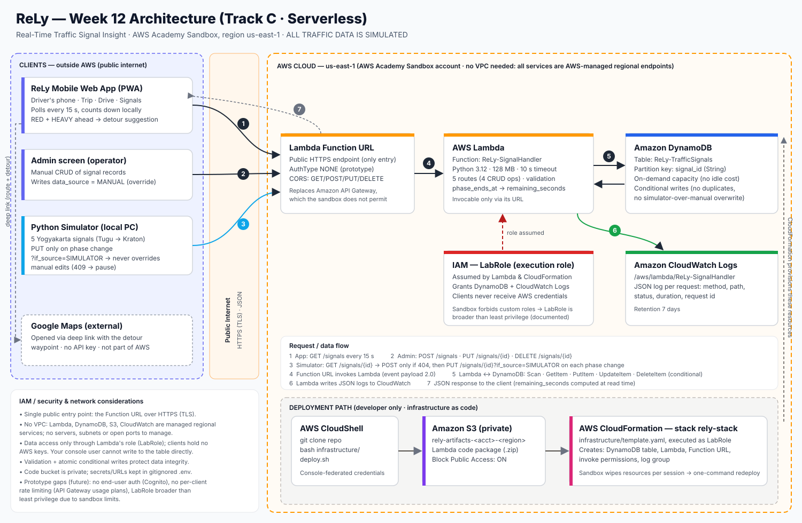

# ReLy — Real-Time Traffic Signal Insight

A traffic-signal monitoring prototype: a mobile-style web app for drivers, a serverless
AWS backend (Lambda + DynamoDB), and a Python simulator that generates the signal data.
**All traffic data is simulated.**

## Architecture



The system has three client types (mobile app, admin operator, Python simulator) talking
to a single public entry point — a **Lambda Function URL** — which invokes the
**ReLy-SignalHandler** Lambda. The Lambda reads and writes a **DynamoDB** table and logs
every request to **CloudWatch**. Infrastructure is defined in a single CloudFormation
template and deployed via `infrastructure/deploy.sh` from AWS CloudShell.

Key design choices:
- **Lambda Function URL** replaces API Gateway (not permitted in the AWS Academy sandbox).
- **`phase_ends_at` stored instead of `remaining_seconds`** — the Lambda recomputes `remaining_seconds = max(0, ceil(phase_ends_at − now))` on every read so countdowns stay accurate.
- **`?if_source=SIMULATOR` guard** — the simulator sends this on every PUT; if an operator has manually edited a signal, the API returns `409 SOURCE_CONFLICT` and the simulator skips that signal.
- **Conditional DynamoDB writes** — prevent duplicate creates and simulator-over-manual overwrites atomically.
- No VPC needed: Lambda, DynamoDB, S3, and CloudWatch are all AWS-managed regional services.

Full details: [`docs/architecture.md`](docs/architecture.md)

---

## Components

| Component | Tech | Purpose |
|---|---|---|
| Mobile web app (`src/`) | React 18, TypeScript, Vite, Tailwind CSS | Trip / Drive / Signals / Admin screens |
| Backend (`backend/`) | Python 3.12 Lambda, boto3 | Routing, validation, CRUD, JSON logging |
| Simulator (`simulator/`) | Python (stdlib only) | Generates phase changes and sends them to the API |
| Infrastructure (`infrastructure/`) | CloudFormation, bash | DynamoDB + Lambda + Function URL; `deploy.sh` / `destroy.sh` |
| Docs (`docs/`) | Markdown + SVG | API spec, architecture, design brief, diagrams |

### App screens

- **Trip** — signals along a route with phase, countdown, congestion level; Google Maps deep link.
- **Drive** — big traffic-light countdown, "after that" signal preview, detour suggestion on RED + HEAVY traffic, voice/vibration toggles.
- **Signals** — searchable list with confidence scores and freshness; tap for a detail sheet.
- **Admin** — add / edit / delete signals (operator edits set `data_source: MANUAL`), mock-data toggle, dark/light theme.

---

## Running locally

**Frontend** (mock data on by default, no backend needed):

```bash
npm install
npm run dev        # dev server at http://localhost:5173
npm run build      # tsc -b + production build
npm run preview    # preview the production build
```

**Backend without AWS** — exact same Lambda handler, in-memory store:

```bash
python backend/local_server.py
# → serves http://127.0.0.1:8787

RELY_API_URL=http://127.0.0.1:8787 python simulator/simulator.py
```

Copy `.env.example` to `.env` and fill in both `VITE_API_BASE_URL` and `RELY_API_URL` to
point the app and simulator at the local server (or the deployed Lambda URL).

**Backend tests:**

```bash
pip install -r backend/requirements-dev.txt   # boto3 + moto[dynamodb]
# then run the tests in backend/tests/
```

---

## Deploying to AWS

Run from the repo root in **AWS CloudShell** (region `us-east-1`, AWS Academy `LabRole`):

```bash
bash infrastructure/deploy.sh    # packages backend/src, uploads to S3, deploys the stack,
                                 # and prints the Lambda Function URL + health check
bash infrastructure/destroy.sh   # tear down all resources
```

Set the printed URL as `VITE_API_BASE_URL` / `RELY_API_URL` in `.env`, then switch the
app's Admin screen off mock-mode and run the simulator.

> **Sandbox note:** AWS Academy resources are wiped when the lab session ends (~3 h).
> Re-run `deploy.sh` at the start of each session — it takes about 2 minutes.

---

## API summary

Full spec: [`docs/api-specification.md`](docs/api-specification.md)

| Method & path | Purpose | Key responses |
|---|---|---|
| `GET /` | Health check | `200 {service, status, time}` |
| `GET /signals` | List all | `200 {items, count, generated_at}` |
| `GET /signals/{id}` | Get one | `200` / `404` |
| `POST /signals` | Create | `201` / `409 ALREADY_EXISTS` |
| `PUT /signals/{id}` | Partial update; optional `?if_source=` guard | `200` / `404` / `409 SOURCE_CONFLICT` |
| `DELETE /signals/{id}` | Delete | `200 {deleted}` / `404` |

---

## Project structure

```
src/                  React app
  App.tsx             All screens, components, app state
  api/signals.ts      REST client
  lib/maps.ts         Google Maps deep-link builder
  mockData.ts         5 simulated Yogyakarta signals (Tugu → Kraton)
  types.ts            Shared TypeScript types

backend/
  src/
    handler.py        Lambda entry point, routing, error model
    repository.py     DynamoDB + InMemorySignalRepository (for local dev)
    validation.py     Input validation
  tests/              Moto-mocked DynamoDB tests
  local_server.py     HTTP shim to run the Lambda handler locally

simulator/
  simulator.py        Phase-change engine; event-driven PUTs
  signals_seed.json   Initial 5-signal dataset

infrastructure/
  template.yaml       CloudFormation: DynamoDB, Lambda, Function URL, log group
  deploy.sh           Package → S3 → CloudFormation deploy
  destroy.sh          Stack teardown

docs/
  api-specification.md
  architecture.md
  architecture-diagram.svg / .png
  design-brief.md
```

---

## Notes & limitations

- **No end-user auth** (prototype; `AuthType: NONE`). Acceptable because all data is simulated. Cognito / IAM-signed requests are planned future work.
- **No live traffic data** — phase times and congestion are simulated by `simulator.py`.
- **Google Maps** is opened by deep link only; no Maps API key is used.
- **LabRole** is broader than least privilege (sandbox forbids creating custom roles); the intended scoped policy is documented in `docs/architecture.md`.
