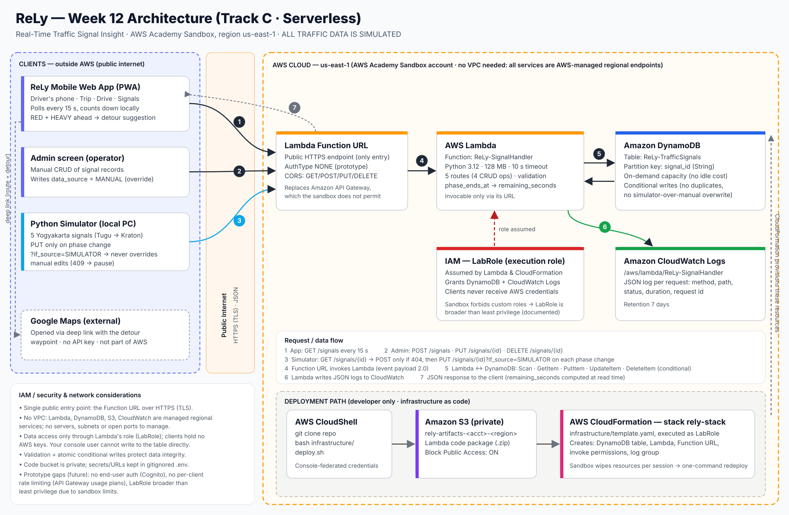
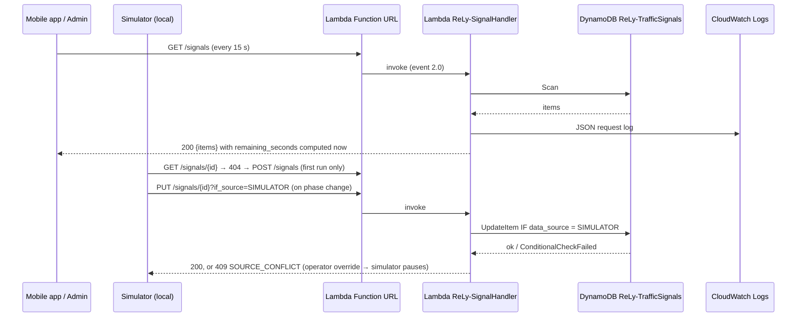

# ReLy — Architecture (Week 12, Track C · Serverless)

*Source: [`architecture-diagram.svg`](architecture-diagram.svg). All traffic data is simulated.*

## 1. Components

| Component | Where | Responsibility |
|---|---|---|
| ReLy mobile web app (PWA) | Driver's phone (browser) | Trip / Drive / Signals screens; polls `GET /signals` every 15 s, counts down locally, warns on RED + HEAVY and offers the stored detour as a Google Maps deep link |
| Admin screen | Same app, operator tab | Manual CRUD; sets `data_source = MANUAL` |
| Python simulator | Developer's PC | Registers 5 demo signals once, then sends a `PUT` on every phase change |
| **Lambda Function URL** | AWS | Public HTTPS endpoint + CORS. Replaces API Gateway (not permitted in the sandbox) |
| **AWS Lambda `ReLy-SignalHandler`** | AWS | Routing, validation, error model, `phase_ends_at` → `remaining_seconds`, JSON logging |
| **Amazon DynamoDB `ReLy-TrafficSignals`** | AWS | Stores `TrafficSignal` records; PK `signal_id`; on-demand; conditional writes |
| **IAM `LabRole`** | AWS | Execution role for Lambda and CloudFormation; grants DynamoDB + Logs access |
| **Amazon CloudWatch Logs** | AWS | `/aws/lambda/ReLy-SignalHandler`, 7-day retention |
| Amazon S3 (private) | AWS | Holds the Lambda code package during deployment |
| AWS CloudFormation `rely-stack` | AWS | Creates all runtime resources from `infrastructure/template.yaml` |
| Google Maps | External | Opened by deep link; not integrated through an API in Week 12 |

## 2. Request / data flow

## 3. IAM / security design
- **Two identities.** The developer's console identity (`voclabs` role) deploys; the
  Lambda's execution role (`LabRole`) reads/writes data. Clients never hold AWS keys.
- **Permission evidence (IAM policy simulator, 26 Nov 2026):** the console identity is
  *denied* `dynamodb:CreateTable/PutItem` and `apigateway:POST`; `LabRole` is *allowed*
  DynamoDB create/read/write and Logs, and also denied `apigateway:POST`. CloudFormation
  is in LabRole's trust policy, so the stack is deployed with `--role-arn LabRole`.
- **Least privilege — honest limitation.** The sandbox forbids creating roles, so the
  Lambda cannot get a role scoped to one table. The intended policy (for a normal account)
  would be: `dynamodb:GetItem, PutItem, UpdateItem, DeleteItem, Scan` on the table ARN and
  `logs:CreateLogStream, PutLogEvents` on the function's log group only.
- **Endpoint protection:** `AuthType NONE` (prototype; data is simulated). Mitigations:
  validation, atomic conditional writes, Lambda invocable only through its URL, CORS limited
  to `GET/POST/PUT/DELETE` + `content-type`, private code bucket, URLs/secrets only in `.env`.

## 4. Network considerations
- No VPC, subnets, security groups or NAT are needed: Lambda, DynamoDB, S3 and CloudWatch
  are AWS-managed regional services, and Lambda reaches DynamoDB over AWS's own network.
- The only public entry point is the Function URL (HTTPS/TLS). Nothing listens on open ports.
- Region pinned to `us-east-1` (sandbox restriction).

## 5. Service availability matrix (AWS Academy Cloud Foundations sandbox)

| Service | Status | How verified |
|---|---|---|
| Lambda (+ Function URLs) | ✅ Available | Policy simulator + real deployment of a test function |
| DynamoDB | ⚠️ Available **via LabRole only** | Policy simulator + real table created by CloudFormation as LabRole |
| API Gateway | ❌ Access denied (implicit deny, user and LabRole) | Policy simulator; not in sandbox README |
| S3 | ✅ Available | Policy simulator (`CreateBucket`, `PutBucketPolicy` allowed) |
| IAM | Read-only; use `LabRole` | Sandbox README + `iam get-role` |
| CloudWatch Logs | ✅ Available | Policy simulator |
| CloudFormation / CloudShell | ✅ Available | Real stack deployment from CloudShell |
| EC2 / RDS | Available with size limits (README); `rds:CreateDBInstance` showed implicit deny in simulator (likely condition-based) | Not tested — not needed for Track C |
| ECR | ❌ Access denied | Policy simulator; not in README → Track B not feasible |

## 6. Limitations
- Sandbox resources are **deleted when the lab session ends** (3-hour sessions) →
  redeploy with `infrastructure/deploy.sh` (~2 minutes) each session.
- No API Gateway → no usage plans/throttling or API keys; Function URL used instead.
- No live traffic data, routing engine or real Google Maps integration (future work).

## 7. Cost & complexity
| Item | Estimate (prototype scale) |
|---|---|
| Lambda | ~10–20 requests/min while simulator runs → far below free-tier-scale costs (< US$0.01/session) |
| DynamoDB on-demand | a few thousand small reads/writes per session → < US$0.01 |
| CloudWatch Logs, S3 | KB–MB of data → negligible |
| Idle cost | ~0 (no servers; on-demand table) |

Complexity is low: one function, one table, one template; no servers, VPC or containers.
